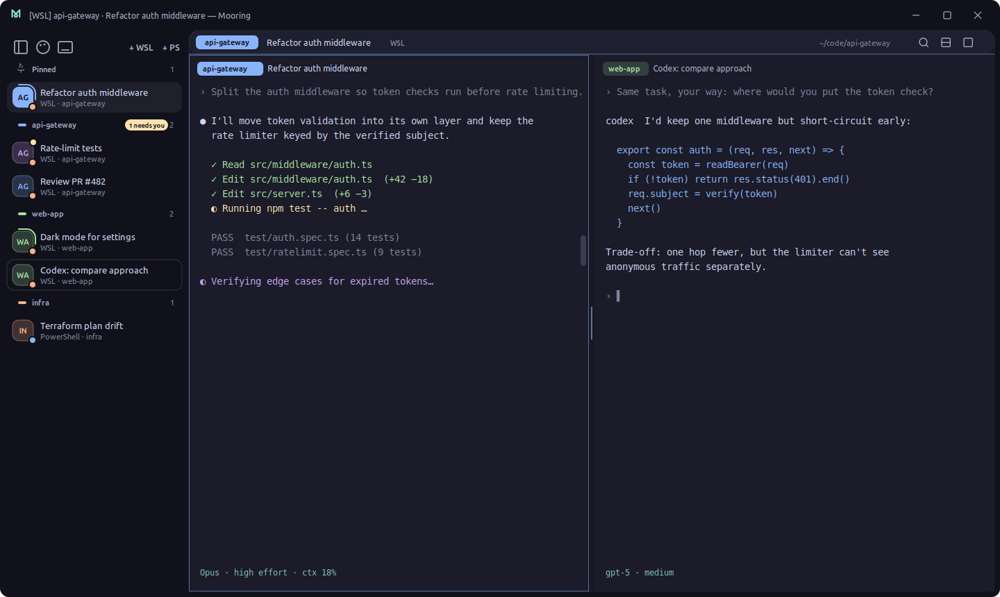

<p align="center">
  
</p>

**Mooring** is a small Windows terminal for people who run several AI coding agents at once
(Claude Code, Codex, agy). WSL and PowerShell tabs live in one window, grouped by repo and
coloured per repo, so you always know which session you are typing into. Shut the PC down at
night; in the morning every tab comes back in its folder with its agent's exact session resumed.

No AI inside the app, no account, about 6 MB.

<p align="center">
  
</p>

## What it does

- **One window, both worlds.** WSL and PowerShell tabs side by side in a vertical sidebar, grouped
  by git repo. Each repo gets a colour (or pick one per tab), shown on the tab, the header and as a
  faint tint behind the terminal; the window title says `[WSL] repo · task` for Alt+Tab.
- **Agent status per tab.** A light runs round a tab while its agent works; a yellow dot (and a
  flashing taskbar button) when it finished while you were looking elsewhere.
- **Sessions survive a shutdown.** After a reboot Mooring asks which tabs to reopen; each one
  starts in its folder and resumes its agent's session (`claude --resume`, `codex resume`,
  `agy --conversation`). See [agent-tabs](#agent-tabs).
- **Hand one agent's context to another.** Drag a tab from the sidebar onto another terminal (or
  right-click → *Bring context into chat*): the source agent's latest turns and the path to its
  full transcript are pasted into the target's prompt, ready for your question. Works across
  tools: Codex can read a Claude session and vice versa.
- **Agents can drive it.** The `mooring` command lets an agent open a split running another agent
  with a prompt, type into another tab, read another tab's screen or chat, and ping you when done:
  *"open a pane on the right and have another Claude fix this bug"*. `mooring install-agents`
  teaches Claude Code (a skill) and Codex (AGENTS.md) about it.
- **Split view** for side-by-side comparisons (handy for demo videos), with labelled halves.
- **Find in the terminal** (Ctrl+Shift+F), **Ctrl+Click** to open file paths and URLs (paths
  with spaces too), a **scroll handle** for full-screen TUIs that pulls faster the further you drag.
- **Calm by default.** Ten themes (Mocha, Tokyo Night, Rosé Pine, Nord, Gruvbox, Midnight, Neon,
  Latte, Rosé Dawn, Paper) with live preview; English and Vietnamese UI.
- **Fast.** WebGL rendering for the tabs on screen, PTY output streamed as raw bytes and batched
  in bursts, one window per app (launching it again brings the running one up).

## Keyboard

| Keys | Does |
|---|---|
| Ctrl+Shift+T / Ctrl+Shift+W | New tab (same shell and folder) / close tab |
| Ctrl+Tab, Ctrl+1…9 | Next tab, go to tab *n* |
| Ctrl+Shift+D / Ctrl+Shift+E | Split left \| right / top / bottom with a new tab |
| Ctrl+Click a sidebar tab | Open it side by side |
| Alt+Arrows, Ctrl+Shift+R, Ctrl+Shift+X | Move between halves, change split direction, unsplit |
| Ctrl+Shift+F | Find in terminal |
| Ctrl+= / Ctrl+- / Ctrl+0 | Text size |
| Ctrl+B | Pin or auto-hide the sidebar |
| Ctrl+Shift+P | Command palette: jump to a tab, run a command |
| Ctrl+Enter / Shift+Enter | New line in an agent's prompt |
| F1 | All shortcuts |

## agent-tabs

The session memory lives in [`agent-tabs/`](agent-tabs), a few small scripts that also work in
Windows Terminal:

- shell hooks (`agent-tabs.bash`, `agent-tabs.ps1`) note which agent each shell starts;
- a systemd user timer records the live session ids every 30 s;
- when a new tab opens in a folder where a session was cut off, it resumes it (press any key
  within 2 s to cancel). Type `agent-resume` to pick one up later, `agent-tabs` to list them.

```bash
./agent-tabs/install.sh   # symlinks into ~/.local/bin and ~/.config, copies the PowerShell side
```

## Build

Mooring is a [Tauri 2](https://tauri.app) app (Rust + vanilla JS + xterm.js), built from WSL for
Windows with [cargo-xwin](https://github.com/rust-cross/cargo-xwin):

```bash
npm install
./deploy.sh dev --restart   # test build: own window, own state, never takes over sessions
./deploy.sh prod            # daily build: staged next to the running one, used on next start
```

`deploy.sh` never kills a running instance (except the dev one with `--restart`); it needs
`clang`, `lld`, `llvm` and `cargo-xwin`. `CARGO_BUILD_JOBS=2` keeps a 4 GB WSL from running out
of memory.

## Project layout

```
src/            UI: main.js (tabs, split, sidebar), themes, i18n (src/locales/*.json), search, links
src-tauri/      Rust: PTYs (portable-pty / ConPTY), state, clipboard, agent context
agent-tabs/     session memory and resume (Python, bash, PowerShell) + its own locales
docs/brand/     logo, icons and README art (build_brand.py, build_mock.py)
docs/planning/  what was considered and left for later
```

Adding a UI language: copy `src/locales/en.json` to `<code>.json`, translate the values, rebuild.
